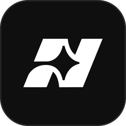
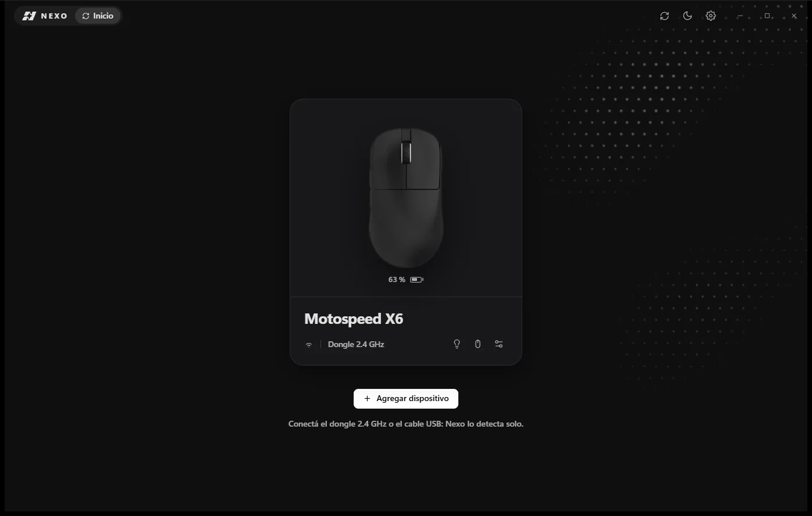
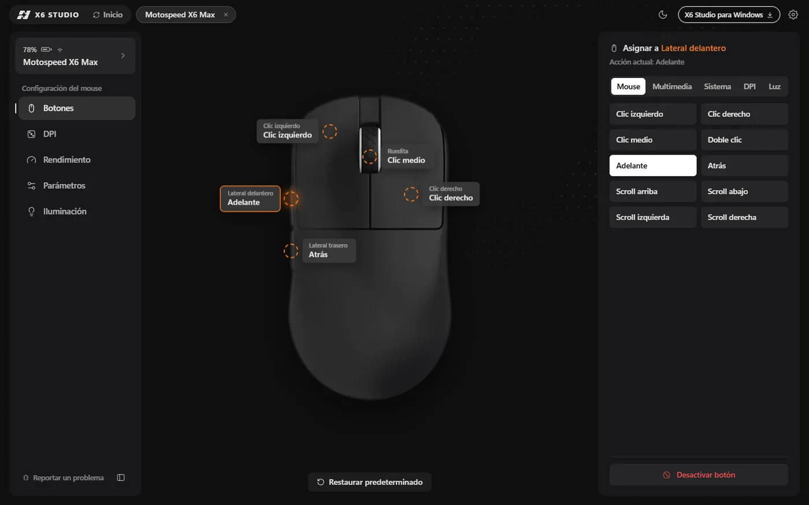
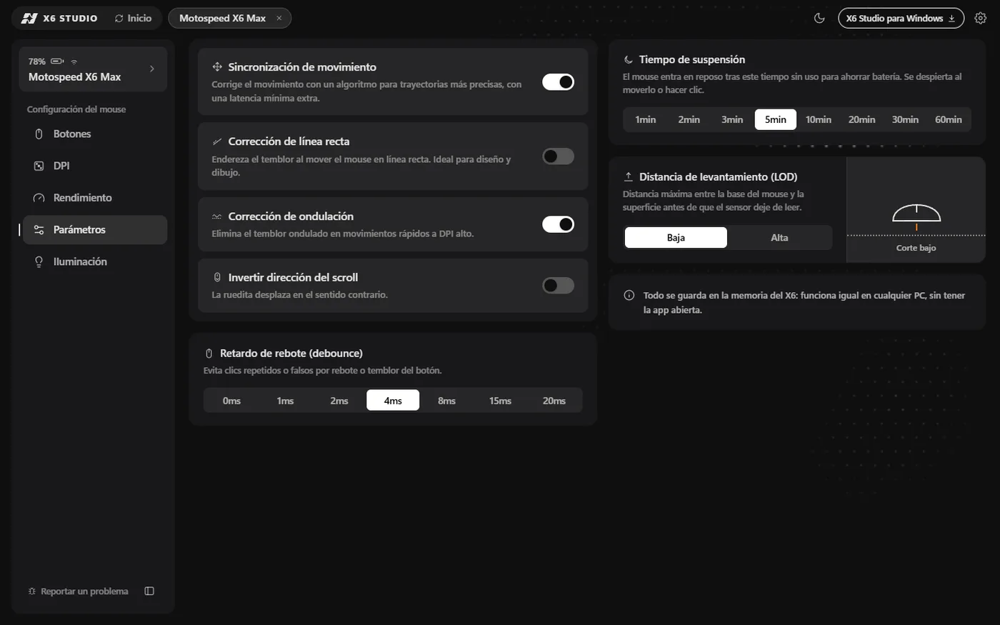
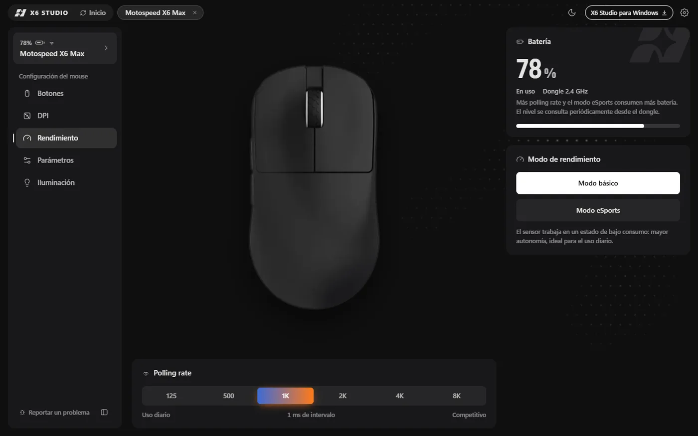
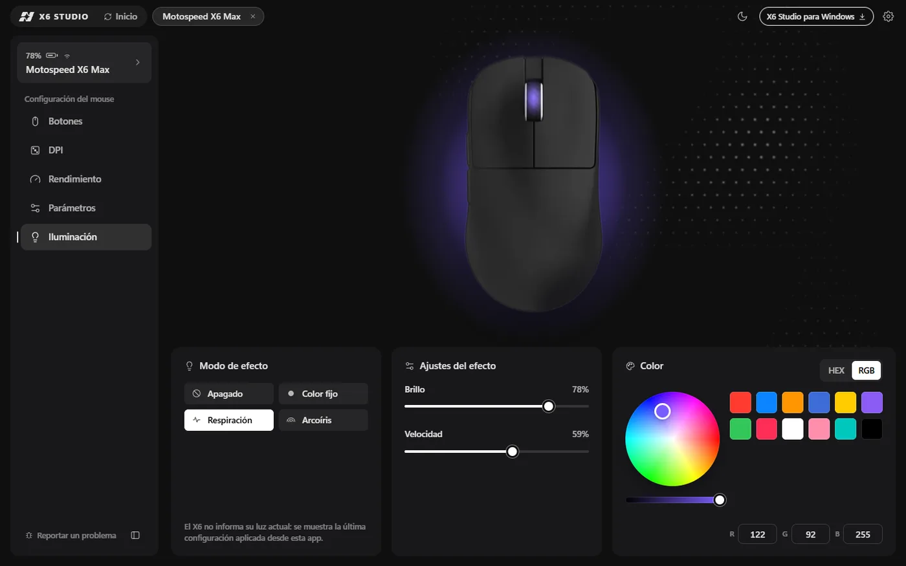
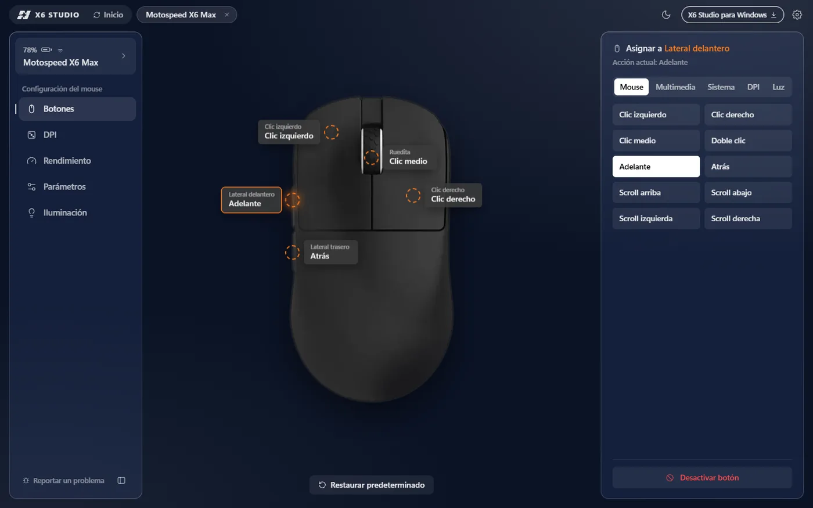
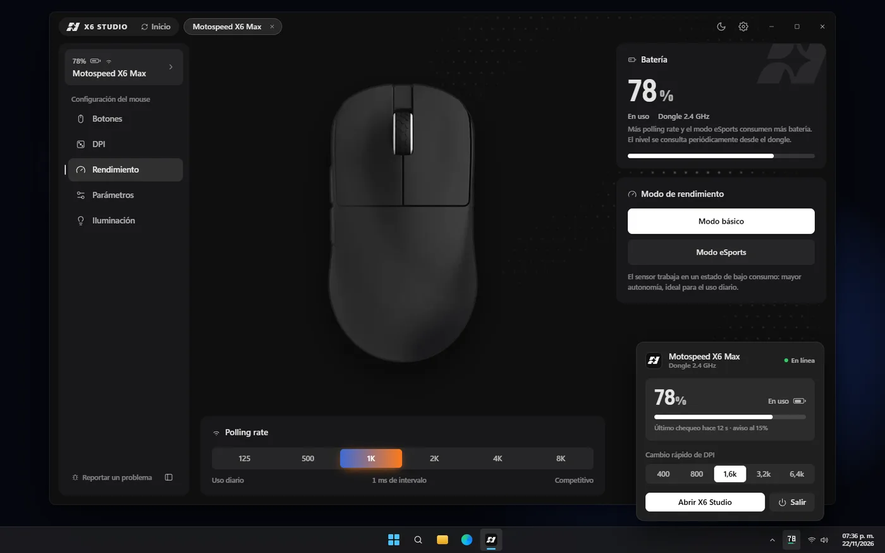
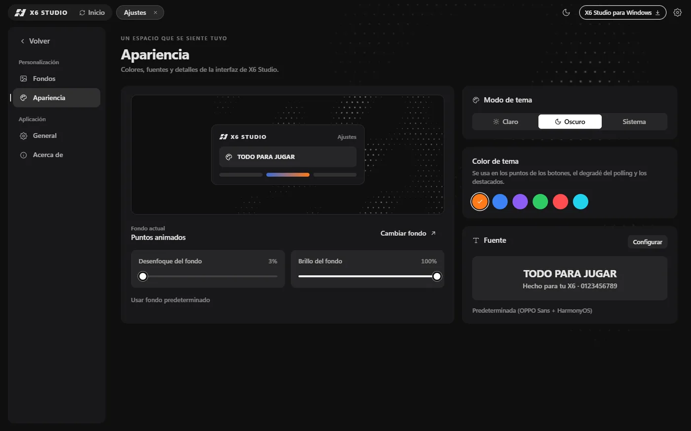
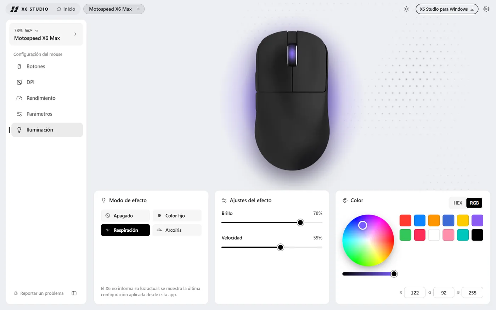

<div align="center">



# Nexo

**El configurador que el Motospeed X6 se merecía.**
Rápido, liviano y en español — en el navegador o como app de Windows, con la batería siempre a la vista.

[](https://NicolasMorelVulliez.github.io/nexo/)
[](https://github.com/NicolasMorelVulliez/nexo/releases/latest)


<br/>



</div>

---

## ✨ Qué hace

| | |
|---|---|
| 🎯 **DPI** | 5 niveles de 100 a 26.000, cuántos están activos y valores rápidos |
| ⚡ **Rendimiento** | Polling de 125 a 8.000 Hz y modo eSports |
| 🖱️ **Botones** | Reasigná los 5 botones: clics, multimedia, atajos, DPI, luz o desactivar |
| 🎛️ **Parámetros** | Motion Sync, corrección de línea recta, ripple, scroll invertido, debounce, suspensión y distancia de levantamiento |
| 💡 **Iluminación** | Apagado, color fijo, respiración y arcoíris, con vista previa en vivo |
| 🔋 **Batería en la barra de tareas** | Un ícono con el porcentaje que cambia de color y se anima al cargar |
| 🎨 **Personalización** | Tema oscuro/claro, color de acento, fondo de puntos animados o vidrio sobre un color, y tu propia fuente o fondo (GIF incluido) |

Todo se guarda en la memoria del mouse: funciona igual en cualquier PC, sin la app abierta.

## 📸 Capturas

<table>
  <tr>
    <td></td>
    <td></td>
  </tr>
  <tr>
    <td></td>
    <td></td>
  </tr>
  <tr>
    <td></td>
    <td></td>
  </tr>
  <tr>
    <td></td>
    <td></td>
  </tr>
</table>

## ⬇️ Descargas

Todo está en la [última versión](https://github.com/NicolasMorelVulliez/nexo/releases/latest):

| Archivo | Para quién |
|---|---|
| `Nexo_x.y.z_x64-setup.exe` | **Recomendado.** Instala solo para tu usuario, sin permisos de administrador. Aparece como “Nexo” en el buscador de Windows. |
| `Nexo_x.y.z_x64_es-ES.msi` | Instalación para toda la PC (empresas / administradores). |
| `Nexo-x.y.z-portable.zip` | Sin instalar: descomprimís y abrís `Nexo.exe` (ideal para pendrive). |

> **Windows dice “Windows protegió su PC”?** Los instaladores todavía no están firmados. Tocá *Más información → Ejecutar de todas formas*.
>
> **No ves la batería al lado del reloj?** Windows 11 esconde los íconos nuevos en la flechita `^`: arrastralo a la barra.

### 🌐 Versión web

Abrí **[NicolasMorelVulliez.github.io/nexo](https://NicolasMorelVulliez.github.io/nexo/)** en **Chrome o Edge**, enchufá el dongle o el cable y tocá *Conectar mouse*.
Nada se instala y nada sale de tu PC: el navegador habla directo con el mouse (WebHID).

¿Querés verla sin mouse? [Modo demo](https://NicolasMorelVulliez.github.io/nexo/?mockup=1).

## 🧩 Compatibilidad

| Dispositivo | Estado |
|---|---|
| Motospeed X6 / X6 Max — dongle 2.4 GHz (`0BDA:FFE0`) | ✅ |
| Motospeed X6 / X6 Max — cable USB (`0BDA:FFF1`) | ✅ (la batería no se informa por cable) |
| Bluetooth | ❌ el protocolo no está disponible |

Windows 10/11 para la app de escritorio. Chrome, Edge u Opera para la web.

## 🛠️ Desarrollo

```bash
npm install
npm run dev          # web en http://localhost:5173  (?mockup=1 para el modo demo)
npx tauri dev        # app de escritorio
```

Compilar la app (requiere Rust MSVC y Visual Studio Build Tools con C++):

```bash
npx tauri build                                               # exe + instaladores NSIS y MSI
powershell -ExecutionPolicy Bypass -File scripts/package.ps1  # arma instaladores, portable y web
```

| Prueba | Comando |
|---|---|
| Protocolo HID (paquetes documentados) | `node --test src/protocol/x6.test.ts` |
| Ícono de bandeja (Rust) | `cd src-tauri && cargo test --lib` |
| Interfaz (clics automáticos) | `node scripts/smoke.mjs` con `npx vite preview --port 4173` |

<details>
<summary><b>Cómo está hecho</b></summary>

```
src/protocol/x6.ts          protocolo HID del X6 (encode / decode)
src/device/live.ts          lee el mouse, envía cambios en cola, batería y preferencias
src/device/webhid.ts        transporte para la web (WebHID)
src/device/tauri.ts         transporte para escritorio (Rust)
src-tauri/src/hid.rs        hilo dueño del HID (hidapi); solo permite los reportes 0xB3 / 0xB5
src-tauri/src/tray_icon.rs  ícono de batería dibujado en tiempo real
src-tauri/src/lib.rs        bandeja, sondeo de batería, ventana, portable e inicio con Windows
src/styles/                 tokens de diseño, fuentes y componentes
src/pages/                  Inicio, Botones, DPI, Rendimiento, Parámetros, Iluminación, Ajustes
```

- Al cerrar la ventana se libera el WebView: en la bandeja Nexo usa ~25 MB de RAM.
- Portable: un archivo llamado `portable` junto a `Nexo.exe` hace que los datos queden en `NexoData`.

</details>

## 🙏 Créditos

- Protocolo HID descubierto por **jchu634** — [X6-Utilities](https://github.com/jchu634/X6-Utilities) (MIT) y su [serie de artículos](https://www.keshuac.com/blog/00012.motospeed-x6-2) (CC BY 4.0).
- Números en **D-DIN** (Datto, SIL OFL 1.1). Si tenés instaladas **OPPO Sans 4.0** o **HarmonyOS Sans**, Nexo las usa.
- Hecho con [Tauri](https://tauri.app), React y Rust.

Proyecto no oficial, sin relación con Motospeed ni con ATK. Las marcas pertenecen a sus dueños.

## 📄 Licencia

[MIT](LICENSE)
